# Пълен независим одит на платформата (2026-11-14)

Основа: `main` @ `0149223` = производство (Release `43383077468`). Само четене; не е променян код, тест, миграция, конфигурация; не е комитвано, пушвано, разгръщано; не са включвани флагове; `.env` не е четен.
Свързани: [FORENSIC_REQUIREMENT_TRACEABILITY.md](FORENSIC_REQUIREMENT_TRACEABILITY.md) · [FORENSIC_SECURITY_REVIEW.md](FORENSIC_SECURITY_REVIEW.md) · [FORENSIC_UX_ACCESSIBILITY_REVIEW.md](FORENSIC_UX_ACCESSIBILITY_REVIEW.md) · [FORENSIC_TEST_EVIDENCE.md](FORENSIC_TEST_EVIDENCE.md) · [FORENSIC_PRODUCTION_DRIFT.md](FORENSIC_PRODUCTION_DRIFT.md) · [FORENSIC_REMEDIATION_BACKLOG.md](FORENSIC_REMEDIATION_BACKLOG.md) · [FORENSIC_RELEASE_DECISION.md](FORENSIC_RELEASE_DECISION.md).

**Конфликт на интереси.** Одиторът е Claude Code, който е писал и преглеждал големи части от кода и от предишните отчети. Никой предишен отчет не е приет като доказателство; където цитирам такъв, е отбелязано. Това не заменя независим човешки преглед.

## 1. Резюме (факти)

* Публичният сайт е жив, стабилен по наблюдаваното и съвпада с кода на `main`. Всички свежи тестове минаха от първия път (API 1797, уеб 1136, e2e 368 + търговски 32+12 + правен 67 + портал 1, пентест 71 проби без неуспех, SEO 264 адреса без проблем; `pip-audit` и `npm audit` без находки).
* Всички търговски функции (конфигуратор, кошница, оферти, акаунти, проекти, документи, качвания, известия, плащания) са **скрити зад флагове в производство** (наблюдавано: 404 на маршрутите, флаговете на уеб `false`). Това е вярно и съвпада със заявеното.
* Няма намерена CRITICAL находка. **HIGH:** `main` не е защитен; няма втори човек. Няколко MEDIUM: непроверена роля на базата в производство, непроверено възстановяване на архив, няма сигнал за 5xx, ограничаване на честотата в паметта, CSP с `unsafe-inline`.
* Целта за мобилен LCP ≤ 2,5 s **не е изпълнена в производството** при моето измерване (3,0–3,1 s в двата режима на `/bg`; 2,5–3,1 s на `/en`). Моето предишно твърдение „2,34 s“ беше за локален стек без мрежа и **не се пренася** в производството.
* Отчетите на предишните одити съдържат остарели или грешни твърдения за състоянието на производството (т. 10), включително мое.

## 2. Основа (три състояния)

Виж [FORENSIC_PRODUCTION_DRIFT.md](FORENSIC_PRODUCTION_DRIFT.md) §1. Кратко: основният чекаут е на стар клон (чисто, 17 назад, 8 напред); GitHub `main` и производството са `0149223`; дайджестите на образите са от журнала на Release, а текущо работещият дайджест не е прочетен от сървъра.

## 3. Архитектура

Стек: Next.js 16 / React 19 / Tailwind 4 (`apps/web`), FastAPI / SQLAlchemy 2 / Alembic / Argon2 (`apps/api`), PostgreSQL 17, Docker Compose, Caddy и Cloudflare отпред, GitHub Actions → GHCR → SSH през Cloudflare Tunnel към Hetzner VPS (`acs-deploy-gate`).

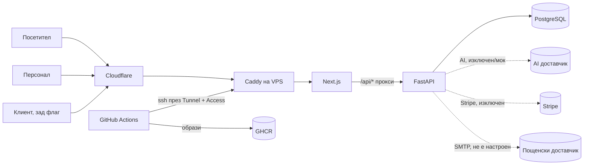

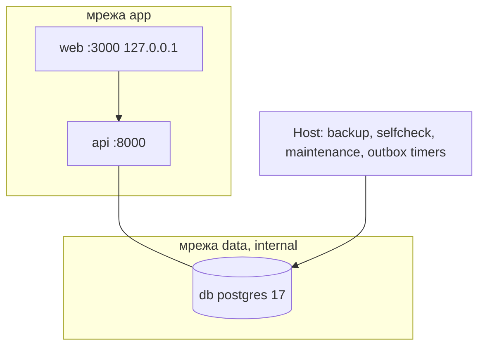

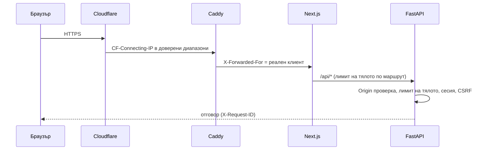

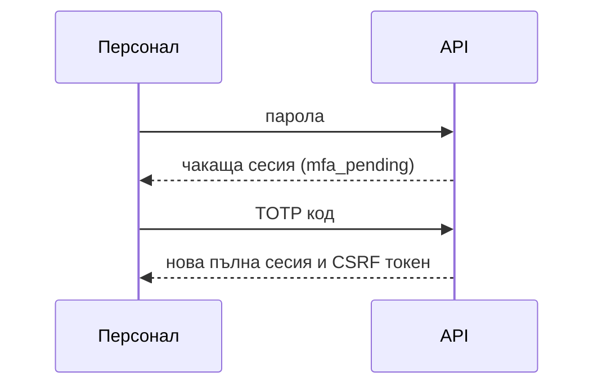

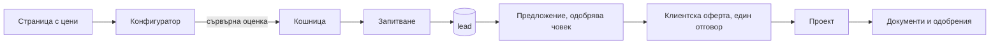

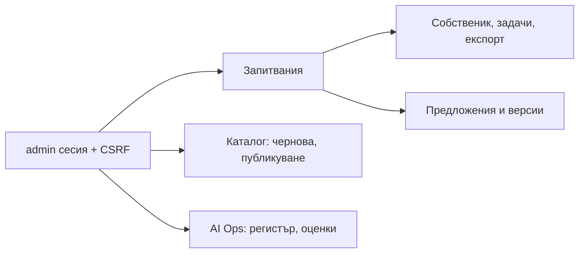

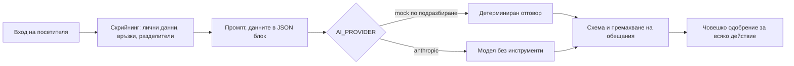

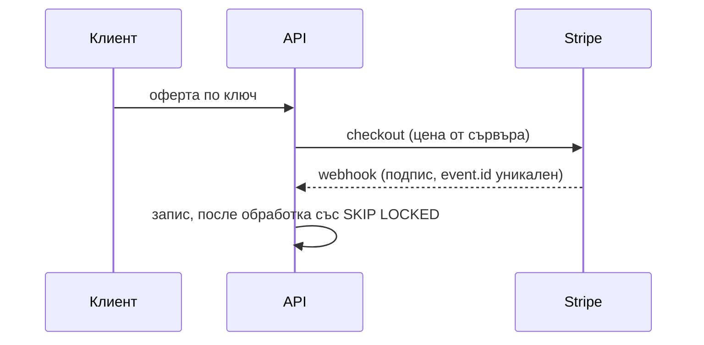

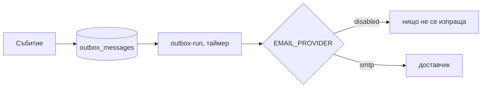

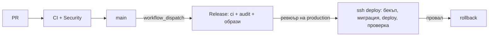

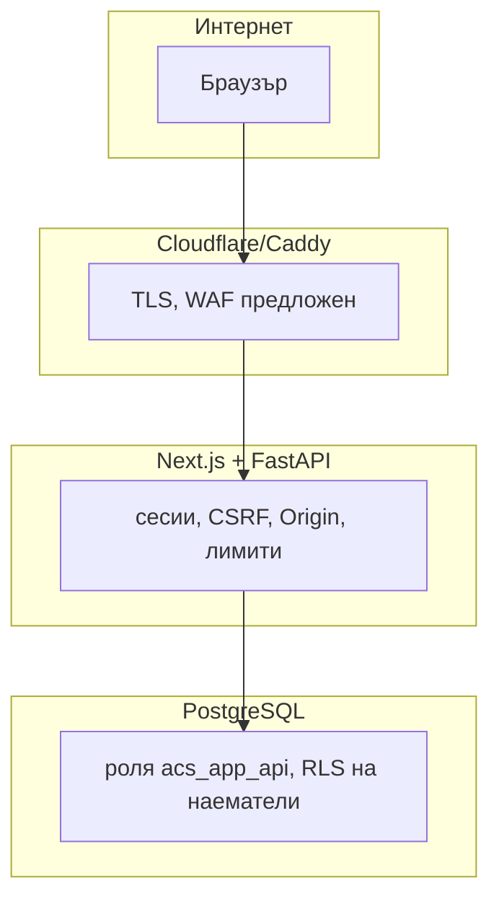

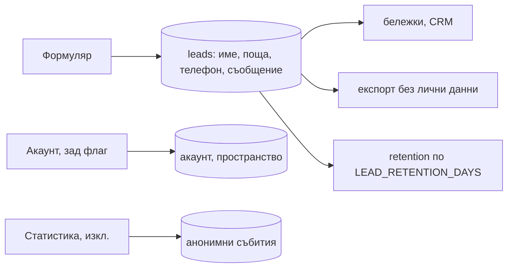

**Три идентичности (не се препоръчва сливане):** персонал (`admin_*`), клиентски акаунти и пространства (`accounts`, `workspace`), клиентски портал на AI Ops (`portal_*`) – отделни таблици, бисквитки, политики на RLS. Доказателство: структура на кода и `test_api_login_role.py`, `test_portal.py`, `test_accounts*.py`.

## 4. Опис на API

277 операции (от `docs/openapi.json`, синхронен с кода според `docs_sync.py`): `admin` 96 (45 четене, 51 запис), `ops` 58 (25/33), `public` 45 (16/29), `accounts` 17, `zone` 14, `portal` 13, `workspace` 13, `projects` 10, `billing` 9, `health` 2.
Оторизация: **153 маршрута** под `/api/admin` и `/api/ops` са обхванати поотделно от `test_route_authorization_inventory.py` (401 без сесия, отказ на запис без CSRF); публичните 29 записа са зад ограничаване на честотата, токен на формата, медовина и строги схеми (`extra=forbid`); клиентските `accounts/zone/workspace/projects/billing` са изключени (404) и не са обхванати от инвентарния тест по маршрут (покриват ги тематични тестове „чужд достъп → 404“). Подробна таблица „метод/път/оторизация“ **за всичките 277** не е изготвяна ръчно: генерира се от OpenAPI (`docs/API_REFERENCE.md` е проверен срещу кода от `docs_sync.py`). Това е ограничение на този одит.

## 5. База и миграции

Една глава `0032`; миграциите `0018` (роля на API), `0023`–`0025` (правни), `0026`–`0032` (търговски) – има тестове върху попълнена база (`test_migration_commercial_populated.py`, `test_migration_legal_populated.py`) за нагоре и за връщане на търговската схема. По документ връщането на `0026`–`0031` е деструктивно (трие таблиците с данни) – не е проверено в този одит. Не е пускано срещу производствена база. Не е правена проверка на индекси/уникалности таблица по таблица.

## 6. Флагове (инвентар)

| Флаг | Подразбиране | Принудително в API | Уеб | Производство (наблюдавано / [Д]) | Бележка |
| --- | --- | --- | --- | --- | --- |
| `CUSTOMER_ACCOUNTS_ENABLED` | false | маршрути 404 + гейтове в `config.py` | `process.env` в 7 места | изкл. (404, `/api/account-flag` false) | |
| `ADVISOR_WORKSPACE_ENABLED` | false | **производството отказва старт** | да | изкл. [Д] | |
| `PROJECT_CONFIGURATOR_ENABLED` | false | 404 | да | изкл. (404, flag false) | гейтът STORAGE-01 затворен |
| `QUOTE_BASKET_ENABLED` | false | 404 | да | изкл. (404) | както по-горе |
| `QUOTATIONS_ENABLED` | false | 404 + ACCEPT-01 | да | изкл. (404) | |
| `COMMERCIAL_PROJECTS_ENABLED` | false | 404 + изисква акаунти | да | изкл. [Д] | |
| `PROJECT_DOCUMENTS/UPLOADS/CLIENT_UPLOADS_ENABLED` | false | 404 + UPLOAD-01 | – (само `PROJECT_UPLOAD_MAX_BYTES`) | изкл. [Д] | |
| `PROJECT_NOTIFICATIONS_ENABLED` | false | изисква проекти+акаунти | – | изкл. [Д] | |
| `BILLING_PROVIDER` | disabled | **производството отказва `stripe`/`sandbox`** | – | disabled [Д] | |
| `CLIENT_PORTAL_ENABLED` | false | маршрути 404 | страницата сама показва „не е отворен“ | API 404, страницата 200 със съобщение | умишлено |
| `ANALYTICS_ENABLED` | false | – | – | [Н] | |
| `LEGAL_CLEANUP_ENABLED`, `EMAIL_DELIVERY_VERIFIED`, `ASSESSMENTS_PREVIEW_ENABLED`, `ADMIN_MFA_REQUIRED` | false | да | – | [Н] (по бележки: MFA изискван) | |
| `TOOL_FLAGS` (уеб) | 15 инструмента `true` | – | да | включени | не са защитна граница |

Няма флаг със стойност `true` по подразбиране в API (`grep`). Няма клиентски-само защитни флагове: всеки уеб флаг има двойник в API със 404.. `PROJECT_UPLOAD_MAX_BYTES` е прочетен от уеб и API поотделно (по-строгият от двата печели).

## 7. Производителност: измерване на производството

Метод: Lighthouse 13.5.0 в Playwright контейнера, мобилен профил, 12 обикновени зареждания на `https://ai-commercestudio.com` (по 3 на адрес и режим), от тази машина (Windows 11, Docker Desktop, домашен интернет; не е „полеви данни“). TTFB при приложено ограничаване е по модел (563 ms).

| Адрес | Режим | Оценка | FCP | LCP | TBT | CLS | Достъпност / BP / SEO |
| --- | --- | --- | --- | --- | --- | --- | --- |
| `/bg` | симулиран | 91, 91, 90 | 1,54 s | **3,11 / 3,04 / 3,12 s** | 183–217 ms | 0 | 100 / 100 / 100 |
| `/en` | симулиран | 94, 91, 95 | 1,39 s | **2,89 / 2,96 / 2,53 s** | 121–222 ms | 0,02 | 100 / 100 / 100 |
| `/bg` | приложен | 74, 74, 73 | 3,03–3,11 s | **3,03 / 3,11 / 3,04 s** | 507–594 ms | 0 | 100 / 100 / 100 |
| `/en` | приложен | 68, 73, 75 | 2,95–3,07 s | **3,07 / 2,95 / 2,98 s** | 525–820 ms | 0–0,02 | 100 / 100 / 100 |

Заключение: LCP е **над 2,5 s** във всички режими на `/bg`; на `/en` само един от шест пробега е около 2,5 s. INP не е измерен (няма полеви данни). Размер на началната страница: 349 KB HTML (1 543 елемента). Приложеният LCP в производството е по-висок от локалния (2,34 s) защото локалният стек няма мрежова латентност и ползва HTTP/1.1 без TLS; затова локалните числа не се пренасят. Допълнителна информация: [PERFORMANCE_BEFORE_AFTER.md](PERFORMANCE_BEFORE_AFTER.md).

## 8. SEO

Проверено на производството (38 от 264 адреса): 200, един `<title>`, canonical = адреса, един `<h1>`. Пълно обхождане на локалния билд: 264 адреса / 280 връзки / 0 проблема (заглавия, описания, hreflang bg↔en, JSON-LD валиден, без `noindex`, без счупени връзки). `robots.txt` забранява `/admin`, `/portal`, `/api/`, `/bg/konto`, `/en/account`; `/admin/login` връща `x-robots-tag: noindex, nofollow`, `Cache-Control: no-store`; `/portal` – `noindex, nofollow, nocache`. Редиректи: `/` → 307 `/bg`, `http→https` 301, `www` → 301, `/bg/` → 308. Структурирани данни на `/bg`: `Organization`, `WebSite`, `FAQPage` (8 въпроса, които са видими на страницата според кода на `Faq`), без оценки, цени или отзиви. Не е проверено: Open Graph картинки поотделно, пълната извадка на производството, страници със силни ключови думи.

## 9. Лични данни (инвентар на ниво тип; не е правен вид „правна годност“)

| Данни | Източник | Цел | Таблица | Обработващ | Срок | Достъп / износ / изтриване | Забележка |
| --- | --- | --- | --- | --- | --- | --- | --- |
| Име, имейл, телефон, съобщение | формуляр за контакт | отговор на запитване | `leads` (+ бележки, одит) | собствена база; пощенски доставчик не е настроен | `LEAD_RETENTION_DAYS`; задача `maintenance` | админ с роля; износ без лични данни; изтриване от админа | **TECHNICALLY IMPLEMENTED**; срок/основание – **LAWYER REVIEW REQUIRED** |
| IP | заявки | защита от злоупотреба | ключован хеш (HMAC), не суров IP | – | в паметта/базата според таблицата | – | TECHNICALLY IMPLEMENTED |
| Акаунт, имейл, парола (Argon2id), сесии | регистрация | клиентска зона | `accounts*` | – | **срокове за запазване не са зададени** (устно: 3 години за отказ и за искания; счетоводен срок неизяснен) | износ/корекция/изтриване от кода; изпълнява се от персонал | OWNER/LAWYER/ACCOUNTANT REVIEW REQUIRED; **изключено** |
| Анонимни събития | статистика | измерване | `analytics_*` | – | `ANALYTICS_RETENTION_DAYS` 180 | – | изключено; описано в политиката |
| Резервни копия | дъмпове на `db` | възстановяване | файлове на сървъра + шифровано външно копие | собственикът | 14 копия | – | съдържат лични данни; ключ за разшифроване само при собственика |
| Логове | stdout, Caddy | операции | Docker `json-file`, Caddy 30 дни | – | 50 MB/контейнер; 30 дни | – | `hide_parameters=True`; IP-адресите в Caddy логове са лични данни (**не е прегледано**) |

Бисквитки/хранилище: `acs_locale`, `acs_cookie_notice`, `acs_session/acs_csrf` (персонал), `acs_account_*`, `acs_portal_*`; `sessionStorage` `acs-quote-bar-dismissed`, `acs:roi:process`, `acs.configurator.<версия>`; `localStorage` `acs.quote-basket`. Всички са описани в политиката за бисквитки (чернова, не е подписана от юрист). Анализ за съгласие: сайтът не зарежда ресурси на трети страни (CSP).

## 10. Точност на документацията

Метод: търсене на твърдения за състояние, сравнение с код/производство. Извадка (не изчерпателно):

| Документ | Твърдение | Оценка | Доказателство | Коригиран текст |
| --- | --- | --- | --- | --- |
| `COMMERCIAL_RELEASE_REVIEW.md` | „миграции 0027–0032 съществуват само в локални и тестови бази“; „следващото Release ще ги носи“ | **CONTRADICTED_BY_PRODUCTION** | журнали на Release: приложени 2026-11-12 (04:23, 05:05 UTC) | „0026–0032 са приложени в производство на 2026-11-11/12“ |
| `COMMERCIAL_EXPANSION_PROGRESS.md` (07, 262) | „0027 в main, не е разгърната“; „0028 само локално“ | CONTRADICTED_BY_PRODUCTION | същото | същото |
| `COMMERCIAL_PROJECTS.md` ред 71 | „0027 не е разгърната“ | CONTRADICTED_BY_PRODUCTION | същото | същото |
| `COMMERCIAL_EXPANSION_FORENSIC_AUDIT.md` (195, 283) | „няма тест на 0026–0032 върху попълнена база“ | **CONTRADICTED_BY_TEST** | `tests/test_migration_commercial_populated.py` (3 теста) | „има тест на търговската схема върху попълнена база“ |
| `PRODUCTION_VS_GITHUB_GAP_REPORT.md` (мой, 2026-11-13) | „производство `88aed98`, `main` е 1 комит напред“ | **STALE** | Release `43383077468` → `0149223` | „производство = main (0149223) към 2026-11-13“ |
| `PRODUCTION_RELEASE_CHECKLIST.md` | §0 описва „следващото Release“ като предстоящо | STALE | същото | обновяване след пускането |
| `docs/IMPLEMENTATION_STATUS.md` и други „369/461/84 passed“ | числа от по-стари пускове | STALE | свежи числа във [FORENSIC_TEST_EVIDENCE.md](FORENSIC_TEST_EVIDENCE.md) | връзка към последния пуск |
| `UI_UX_AUDIT.md` (мой) | достъпност „100“ без забележки | **PARTIALLY_SUPPORTED** | A-01 (етикет в името) е бил в производство до `0149223` и е хванат от axe 4.14 | добавена находка A-01 |
| `PERFORMANCE_BEFORE_AFTER.md` (мой) | „/bg LCP 2,34 s“ | **PARTIALLY_SUPPORTED** (само локално) | производство 3,0–3,1 s | уточнение: лабораторна стойност без мрежа |
| `README.md`, `docs_sync` | всеки документ е свързан | **SUPPORTED** | `docs_sync.py` минава | – |

## 11. Мъртъв код и непоследователности

Виж FS-10 и [FORENSIC_REMEDIATION_BACKLOG.md](FORENSIC_REMEDIATION_BACKLOG.md). Допълнително: 28 `eslint-disable` в уеб кода (15 за `react-hooks/set-state-in-effect`, 11 за `exhaustive-deps`) – не са прегледани един по един; 0 `any`, 0 `@ts-ignore`, 0 `TODO/FIXME` в нетестов код; 5 широки `except Exception` в API (всички преразпращат). Няма маршрути на API, които не са регистрирани (проверено срещу `main.py`). Няма твърдо кодирани контакти извън `company.ts` и тестовете.

## 12. CI/CD и инфраструктура

* `.github/workflows`: `ci.yml`, `audit.yml`, `release.yml`, `security.yml`, `uptime.yml`; действията са закрепени по SHA; `Release` е само ръчно; `deploy` изисква ревюър на `production`; **`main` е незащитен** (FS-01).
* Docker: образите на API и уеб са под непривилегирован потребител; `cap_drop: ALL`, `no-new-privileges`; API с `read_only`, `tmpfs /tmp`; бази в `internal` мрежа без публикуван порт (от `infra/deploy/compose.yml`, не от прочетен сървърен файл).
* Cloudflare/Caddy: виж [FORENSIC_PRODUCTION_DRIFT.md](FORENSIC_PRODUCTION_DRIFT.md) §4: правилата са предложения.

## 13. Наблюдаемост и възстановяване

JSON логове с `request_id`, `/api/health` и `/api/health/ready` (база + `host`), самопроверка на хоста на 15 минути, `Uptime` workflow на 10 минути (зелен), дъмп преди миграция (журнал: `acs-20261113-072359.dump`, 424K, 89 таблици с данни), шифровано външно копие според бележките на собственика. **Няма** сигнал за 5xx, метрики, табла; **няма доказателство за упражнение на възстановяване върху сървър**. Затова възстановяването е **DEPLOYED_NOT_VERIFIED**.

## 14. Оценки (0–100, с основание)

Оценките са мои и качествени; не са награда за документация.

| Област | Оценка | Основание |
| --- | --- | --- |
| Яснота на продукта | 80 | ясен H1/призиви; конфигуратор и кошница невидими |
| Дизайн на интерфейса | 78 | последователна тъмна система; само извадка от живо |
| UX и конверсия | 60 | работи само формата за контакт; търговският път е скрит |
| Отзивчив дизайн | 85 | 0 px преливане във всички измервания; няма всички ширини на живо |
| Достъпност | 72 | Lighthouse 100, axe зелен; A-01 пропускан до скоро; без ръчен преглед/екранен четец |
| Български текст | 65 | не е прегледан от човек в този одит |
| Английски текст | 65 | същото |
| Интернационализация | 82 | паритет на структура/маршрути/hreflang |
| Фронтенд инженерство | 78 | 0 `any`/`@ts-ignore`; 5 мъртви компонента; 28 потискания |
| Бекенд инженерство | 82 | чиста структура, валидация, транзакции; всички маршрути регистрирани |
| Качество на API | 78 | схеми и грешки; няма пълна ръчна таблица за 277 операции |
| Цялост на базата | 80 | една глава, тестове върху попълнена база, RLS |
| Удостоверяване | 80 | Argon2id, MFA, заключване; производствената му конфигурация не е видяна |
| Оторизация | 85 | 153 маршрута доказани автоматично; клиентските зад флаг |
| Изолация на наематели | 78 | RLS + роля; ролята в производство не е потвърдена |
| Сигурност на приложението | 76 | без CRITICAL; CSP `unsafe-inline`, лимит в паметта |
| Инженеринг на личните данни | 62 | срокове не са зададени, политиката е чернова |
| Безопасност на AI | 70 | без инструменти и проверка на изхода; реален доставчик непроверен |
| Търговски процес | 55 | кодът е тестван локално; почти всичко изключено; мокове |
| CRM/админ | 70 | доказана оторизация; на живо не е тестван |
| Плащания | 35 | само фалшив шлюз |
| SEO | 88 | пълно обхождане + извадка на производството |
| Аналитика | 40 | изключена, не е проверена |
| Производителност | 62 | LCP > 2,5 s на производството; INP непознат |
| Качество на тестовете | 65 | реални, без повторения; надути броя; 94 пропуснати; мокове за плащания/AI |
| Покритие на тестовете | 70 | широко, но търговските/правните пакети не са в GitHub CI |
| DevSecOps | 60 | закрепени действия, сканиране; `main` незащитен, Dependabot security изкл. |
| Безопасност на разгръщането | 72 | ръчно, с ревюър, бекъп преди миграция, автоматично връщане |
| Наблюдаемост | 45 | жив uptime и самопроверка; без сигнал за 5xx и метрики |
| Резервно копие и възстановяване | 45 | дъмпове има; възстановяване непроверено |
| Точност на документацията | 55 | най-малко 6 документа с остарели твърдения за производството |
| Готовност на производството (текущ обхват: публичен сайт + админ) | 70 | жив и стабилен; празнини в операциите |
